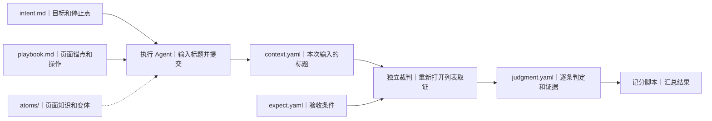
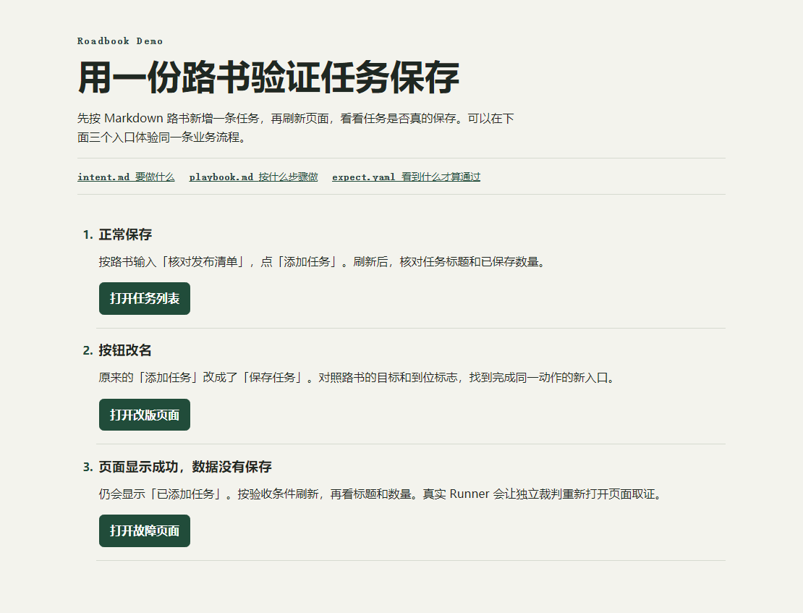

# Roadbook Runner

**Roadbook Runner** —— 独立运行 [Roadbook](https://github.com/ouylzq/roadbook) 的文本化 UI 测试资产。
每个场景用 `intent.md` 写目标与边界、`playbook.md` 记录已验证的操作步骤、`expect.yaml` 定义独立验收路线；Runner 读取这些文件执行任务、取证并给出结论。它提供可视化看板，每个场景可以单独触发，运行过程有录屏和结构化结果。

## Demo：用一份 Markdown 路书验证任务保存

这个场景验证「核对发布清单」这条新任务能否保存。执行 Agent 照路书提交，独立裁判重新打开任务列表，核对标题和数量。



### 1. 先写清场景目标和停止点

Runner 把 `intent.md` 和 `playbook.md` 交给执行 Agent。下面是演示场景的 [intent.md 节选](examples/demo/skills/roadbook-demo/scenarios/save-task/intent.md)。

```markdown
## 目标

在 http://127.0.0.1:4173/tasks 新增一条标题为「核对发布清单」的任务。

## 适用场景

用任务保存流程练习编写路书、处理页面文案变动，以及查看独立裁判的取证结果。三种页面版本都使用同一个入口和同一份场景资产，由启动命令选择本次版本。

## 数据与前置条件

- 演示服务已在本机启动。场景无需账号或登录。
- 标题固定为「核对发布清单」。Runner 的每次执行使用新的浏览器上下文，任务数据按演示会话隔离，同一会话最多保存一条任务。
- 本场景只执行一次提交。提交后保留现场，服务退出时清空演示数据。

## 执行边界

只操作本机演示页面。看到「已添加任务」和任务标题后停在当前页，交给裁判重新打开任务列表。遇到明确的加载或提交错误时，记录页面原文和停在哪一步。

## 交接事实

- `task_title` 是本次实际输入的完整标题。应从操作现场记录该值，以便裁判核对重新加载后的列表。
- 验收条件由 `expect.yaml` 维护。提交反馈和运行备注可以用于回看操作。
```

### 2. 执行 Agent 照 Markdown 路书操作

这份 [playbook.md](examples/demo/skills/roadbook-demo/scenarios/save-task/playbook.md) 会在运行时直接交给 Agent。示例把流程拆成三步。每步都写清目标、页面锚点、操作和可观察的到位标志。

```markdown
## 步骤

1. 【参考】task-list-page
   【目的】确认已进入演示任务列表，表单可以操作
   【锚点】页面主标题「任务列表」，以及「已保存的任务」区域
   【动作】核对当前页面。尚未打开任务列表时，导航到 intent.md 的入口地址。等「正在读取任务…」变成「已保存任务」计数
   【到位标志】列表区域显示计数，「任务标题」输入框可用

2. 【参考】task-create-form
   【目的】把本次任务标题写进表单
   【锚点】「任务标题」输入框，空值时显示「输入任务标题」
   【动作】填写 intent.md 指定的标题。输入框有残留时先清空，再写入完整标题
   【到位标志】输入框中显示完整标题，表单的提交按钮可用

3. 【参考】task-create-form
   【目的】提交本次任务并取得页面反馈
   【锚点】同一表单内的「添加任务」按钮
   【动作】核对输入框标题后，点击「添加任务」一次，等待页面反馈
   【到位标志】页面显示「已添加任务」，列表中出现刚输入的标题
```

#### 锚点失配时，查该步引用的原子

原子是可复用的单个页面或控件的操作知识。第 1 步引用[任务列表页原子](examples/demo/skills/roadbook-demo/atoms/task-list-page.md)了解列表何时就绪，第 2、3 步共用[新增任务表单原子](examples/demo/skills/roadbook-demo/atoms/task-create-form.md)。例如第 3 步找不到「添加任务」时，可以查阅原子里的变体，再到页面验证。

```markdown
## 变体

- 按钮改名版使用「保存任务」。输入框标签和提交反馈相同，确认按钮在同一表单内后可按原动作提交。
- 原生表单支持在输入框中按 Enter 提交。提交前先核对输入框中的完整标题，选择一次提交方式。
```

操作完成后，Runner 把 Agent 交出的本次事实写进 `storage/<run_id>/context.yaml`。

```yaml
task_title: 核对发布清单
```

### 3. 独立裁判按验收条件重新取证

裁判在新的浏览器上下文中继承本次演示会话，按 [expect.yaml](examples/demo/skills/roadbook-demo/scenarios/save-task/expect.yaml) 重新打开任务列表。`context.task_title` 引用刚才交接的实际标题，数量要求由验收文件指定。

```yaml
goal: 确认任务保存后，重新打开列表仍能读到同一条任务
steps:
  - go: 重新打开 http://127.0.0.1:4173/tasks，等待「已保存任务」计数出现，再读列表
    check:
      - 任务列表中存在标题为 context.task_title 的任务
      - 计数显示「已保存任务：1」
```

正常保存时，裁判的 `judgment.yaml` 中可以看到下面这样的答卷。每条 `fact` 对应一条验收条件，`evidence` 是裁判重新打开页面后读到的原文。

```yaml
steps:
  - step: 1
    reached: true
    how: 重新打开任务列表并读取页面文字
    check:
      - fact: 任务列表中存在标题为 context.task_title 的任务
        result: pass
        evidence: 核对发布清单
      - fact: 计数显示「已保存任务：1」
        result: pass
        evidence: 已保存任务：1
```

记分脚本检查答卷是否与验收条件对应、证据是否齐全，再汇总为 `PASS`、`FAIL` 或 `BLOCK`。看板的运行详情可以一起查看操作录屏和裁判结果。

### 4. 换一个页面版本，观察同一份路书怎么跑

| 页面版本 | 执行时发生什么 | 裁判的预期结论 |
| --- | --- | --- |
| 正常保存 | 点「添加任务」，页面显示「已添加任务」 | `PASS`。重新打开后能读到任务，计数为 1 |
| 按钮改名 | 「添加任务」变成「保存任务」。Agent 走通新入口后可以更新路书的锚点和动作 | `PASS`。沿用同一份验收条件 |
| 保存丢失 | 页面同样显示「已添加任务」，临时列表也有标题 | `FAIL`。重新打开后读到「还没有任务。」和「已保存任务：0」 |

按钮改名时，确认新按钮提交成功后可以更新第 3 步。团队可以在 Git diff 里直接审阅改动。

```diff
-   【锚点】同一表单内的「添加任务」按钮
-   【动作】核对输入框标题后，点击「添加任务」一次，等待页面反馈
+   【锚点】同一表单内的「保存任务」按钮
+   【动作】核对输入框标题后，点击「保存任务」一次，等待页面反馈
```

### 在本地体验

从仓库根目录运行 `python examples/demo/demo.py`，打开 [本地导览](http://127.0.0.1:4173/)。手动体验只需要 Python 3.12+ 和浏览器。



安装依赖并配置模型后，先停止预览，再运行下列命令体验完整流程。安装步骤、看板用法和实验结果的查看方式见[演示指南](examples/demo/README.md)。

```sh
python examples/demo/demo.py run
python examples/demo/demo.py run --variant renamed
python examples/demo/demo.py run --variant lost-write
```

也可以运行 `python examples/demo/demo.py dashboard`，打开 [Runner 看板](http://127.0.0.1:8900/)，点击「保存一条任务」启动场景。

## 它是什么

一个以文本路书为运行时测试资产的浏览器自动化 QA Agent。浏览器执行层使用 Playwright Python SDK 启动并控制 Chromium。每个场景的操作知识保存在可读、可审阅的 Markdown 中，Agent 依据路书和当前页面状态执行；验收条件单独保存在 `expect.yaml`，交由独立裁判重新取证。

项目的重点不是让 Agent 从零探索页面，而是让团队维护一份能在运行时直接使用的文本路书。探索只在路书尚未覆盖或页面变化时补充步骤。

Runner 不为每个场景生成一份固定的 Playwright 测试脚本，也不依赖预先写死的页面 Selector，而是

* 理解业务目标（读路书的 intent）
* 读取 DOM/ARIA 语义快照，按角色、文案等信息定位页面元素
* Observe → Act → Observe 短反馈循环推进
* 由**独立裁判**按验收路线取证判定，证据必须是页面原文
* 输出结构化报告 + 录屏
* 路书按单步结构化事件异步沉淀，业务执行不等待整份 Markdown 重写
* runner 不按固定轮数误杀，使用墙上时钟、页面停滞和人工停止三道安全闸

## 文本路书如何成为测试资产

`playbook.md` 记录下一次运行可复用的操作知识。上面的保存任务示例中，每一步都有参考知识、目的、页面锚点、动作和到位标志。

Agent 按已验证的步骤继续执行；若锚点或页面反馈发生变化，就在当前页面重新确认并更新受影响的步骤。Runner 通过结构化写入工具逐步更新 Markdown，并校验必需字段，避免整份路书被一次模型输出覆盖。路书 diff 可以直接审阅和版本管理。

业务目标、操作路径和验收判据分开维护：`intent.md` 说明目标与运行边界，`playbook.md` 记录 Agent 如何操作，`expect.yaml` 规定裁判需要检查哪些业务事实。这样调整操作步骤不会悄悄改动验收标准。

设计思路和实现细节见[文本化测试资产设计说明](docs/roadbook-text-native-testing.md)。

## 运行原理

```text
路书 + 页面观察结果
          ↓
   AI 选择下一步工具
          ↓
Runner 工具层校验并分发调用
          ↓
Python Playwright 操作 Chromium
          ↓
读取新的 DOM/ARIA 快照与页面文本
          └────────────返回给 AI
```

模型通过工具调用决定下一步，例如观察页面、点击一个引用、输入文字或上传文件。Runner 将这些调用交给 Playwright 驱动执行，动作完成后重新观察页面，再把结果交回模型。点击和输入使用 Playwright 页面 API，上传使用 `set_input_files`。看板实时预览画面时，Runner 通过 Playwright 创建 CDP 会话来推送 screencast 帧。

因此，项目使用的是 **AI 驱动的 Playwright 浏览器自动化**。模型动态选择操作，Playwright 负责实际控制浏览器。

## 运行已有的 Roadbook 资产

```bash
python3 -m venv .venv && .venv/bin/pip install -r requirements.txt
.venv/bin/playwright install chromium
cp .env.example .env          # 填 LLM 地址/密钥/模型；按需配置 Vercel bypass

# 起 demo 靶子
python3 -m http.server 4173 --directory "${ROADBOOK_REPO:-../roadbook}/demo-app" &

.venv/bin/python run.py list
.venv/bin/python run.py run demo-app/todo-complete
.venv/bin/python run.py serve                   # 打开 http://localhost:8900
```

## LLM

走 OpenAI 兼容协议，改 `.env` 三行即可换供应商（Claude 官方、任意 OpenAI 兼容网关都行）：

```
QA_AGENT_BASE_URL=https://api.anthropic.com/v1/
QA_AGENT_API_KEY=sk-ant-xxx
QA_AGENT_MODEL=claude-sonnet-5
```

## 目录

```
agents/     agent.md（唯一主 agent）+ judge.md（独立验证，需要干净上下文）
skills/     技能（roadbook 挂在这里）
frontend/   看板前端
runtime/    引擎：loop / session / context / events / traces
tools/      browser · recorder · validator
knowledge/  facts · experiences · reflections
storage/    跑批产物（录屏、截图、判定）
reports/    markdown 报告
```

路书资产来自开源的 [roadbook](https://github.com/ouylzq/roadbook) 仓库，默认通过 `ROADBOOK_REPO=../roadbook` 读取。

## 一个主 agent + 一个独立验证

只有 `agents/agent.md` 一个执行体，拿到全部工具（浏览器 + 读资源 + 跑脚本 + 写资产）。
"照路书走""自己探索""新建场景"这几种情形不是不同的角色，是代码在调用前拼好的
不同任务说明（`runtime/prompts.py`），模型不需要自己从提示词里判断"我现在该干嘛"。

`agents/judge.md` 定义了独立裁判。它在新的会话中按验收路线读取页面证据。白名单保留用于导航的点击工具，裁判协议限制点击用途，工具列表没有填写表单的能力。

## 许可

MIT
