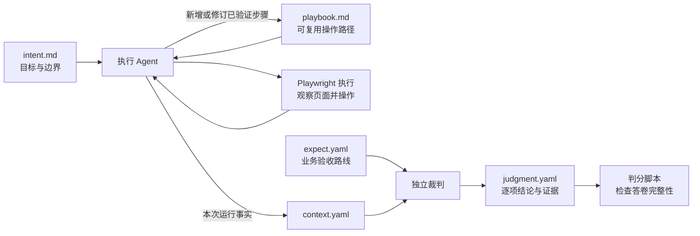

# 把测试经验写成路书：RoadBook 的文本化测试资产

UI 自动化最常见的资产是一段测试代码：定位按钮、点击、填写表单，再用断言检查结果。代码精确、可重复，适合路径稳定、需要高频回归的场景。

但不少业务流程有大量页面细节和分支，UI 也会持续变化。每次变更都直接改脚本，操作知识便容易锁在代码里。RoadBook 选择把这些知识保存为人能读、能审阅的文本路书，并让 Agent 在运行时直接使用它。

**RoadBook 的核心特色不是“让 Agent 自己探索”，而是把 Markdown 路书做成运行时测试资产。** Agent 探索页面，是路书尚未覆盖或界面发生变化时补全资产的方式；独立裁判则负责按业务要求验收。

RoadBook 有规范和执行器两个层次：[roadbook 仓库](https://github.com/ouylzq/roadbook)规定场景、路书、验收条件及运行时契约；[roadbook-runner](https://github.com/ouylzq/roadbook-runner)是其中一种具体实现，负责模型调度、Python Playwright 浏览器控制、运行记录和看板。规范把场景资产描述为业务能力和页面知识，具体工具如何提供这些能力则由运行时适配层说明。[运行时契约](https://github.com/ouylzq/roadbook/blob/main/references/runtime-contract.md)

## 路书不是探索报告

如果 Markdown 只记录“Agent 刚才做了什么”，它就是一份日志。RoadBook 的路书则描述下一次运行可以采用的操作路径。Runner 会把它读入任务，让 Agent 参考已确认的步骤继续执行。

Runner 中的一步由参考知识、目的、页面锚点、动作和到位标志组成：

```markdown
## 步骤

1. 【参考】任务列表
   【目的】进入任务列表
   【锚点】页面标题“我的任务”
   【动作】打开任务列表
   【到位标志】任务列表标题和新增按钮可见
```

这是可读的文本，同时也有明确结构。Runner 的路书读写模块会解析并验证这些字段；Agent 通过 `upsert_playbook_step` 一次提交一条已验证的步骤，由程序生成 Markdown 并原子写入文件。它不用整份重写路书，更新的内容也可以通过 Git diff 审阅。[路书解析与渲染](https://github.com/ouylzq/roadbook-runner/blob/main/runtime/playbook.py) · [单步写入工具](https://github.com/ouylzq/roadbook-runner/blob/main/tools/upsert_playbook_step.py)

## 文本资产如何参与一次运行

RoadBook 把测试信息分开放置，让执行 Agent 和裁判各自读取所需内容：

| 文件 | 记录什么 | 主要使用者 |
| --- | --- | --- |
| `intent.md` | 业务目标、固定条件和运行边界 | 执行 Agent |
| `playbook.md` | 已确认的操作路径 | 执行 Agent |
| `expect.yaml` | 需要验证的业务事实和有序验收路线 | 独立裁判 |
| `atoms/*.md` | 页面节点知识、变体和已知操作问题 | 执行 Agent 按需查阅 |

执行 Agent 读取目标和路书，观察当前页面，选择下一步操作。走通新步骤或修复失效步骤后，它可以把已验证的变化写回路书。执行结束时，Runner 将本次输入和对象信息等事实交给裁判。



RoadBook Runner 的提示词会把 `playbook.md` 放入每次场景任务中；当某一步找不到锚点或页面反馈不符时，Agent 可以在当前页面重新确认路径，再更新对应步骤，而不是把整条测试作废。[场景提示词组装](https://github.com/ouylzq/roadbook-runner/blob/main/runtime/prompts.py) · [场景运行提示](https://github.com/ouylzq/roadbook-runner/blob/main/prompts/run_scenario.md)

这让路书同时承担了三种作用：

- **团队知识**：人可以读懂测试如何经过业务界面，不必先从一段脚本里还原意图。
- **运行输入**：Agent 每次执行都能参考这些已验证的操作步骤。
- **变更记录**：路书 diff 显示哪些步骤发生变化，方便团队复核操作经验是否仍然成立。

文本并不代表随意。路书说明“怎么走”，验收文件说明“什么结果才算满足”。把两者分开，可以在调整操作路径时，避免顺手改掉业务验收标准。

## 为什么还要独立裁判

执行成功只说明 Agent 完成了页面操作，不一定意味着业务结果正确。界面可能先显示“已保存”，但刷新后数据并未持久化；新增项目也可能只存在于前端状态。

因此，RoadBook 在执行之后启动独立裁判。裁判有新的会话和浏览器上下文，不读取执行 Agent 的对话与路书，只按 `expect.yaml` 指定的路线重新进入页面取证。它逐项写出判定和页面证据；判分脚本检查步骤、判据和证据是否齐全，再汇总为 PASS、FAIL 或 BLOCK。[裁判配置](https://github.com/ouylzq/roadbook-runner/blob/main/agents/judge.md) · [执行与裁判的会话交接](https://github.com/ouylzq/roadbook-runner/blob/main/runtime/session.py) · [判分适配器](https://github.com/ouylzq/roadbook-runner/blob/main/runtime/validator.py)

脚本只检查答卷结构，不会独立证明裁判的语义判断一定正确。这条边界很重要：RoadBook 增加了取证和隔离机制，但业务判定仍需要设计清楚的验收条件，也可能需要人工复核。

## 和 Playwright 测试代码怎么选

RoadBook 使用 Python Playwright 控制 Chromium。它不是另一种浏览器驱动，也不意味着 Playwright 只能写固定脚本。Playwright Test 的脚本、断言、fixture、CI 和 Trace 能力，对于明确稳定的回归路径非常合适。

差异主要在测试资产和运行组织上：

| | Playwright Test | RoadBook Runner |
| --- | --- | --- |
| 核心运行资产 | 可执行测试代码与断言 | 可读路书、验收条件与页面知识 |
| 路径如何决定 | 测试代码预先描述操作顺序 | Agent 参考路书，并结合当前页面执行 |
| 路径变化时 | 修改或修复测试代码 | Agent 可重新确认受影响步骤并更新路书 |
| 结果如何检查 | 测试中的代码断言 | 独立裁判依业务路线取证，判分程序检查答卷完整性 |
| 更适合的场景 | 稳定、确定、高频运行的回归 | 操作知识希望以文本维护、界面存在变化且需要业务级证据的流程 |

Playwright 也可以搭配 Agent、独立裁判和文本文件实现相似工作流。RoadBook 的价值在于把这套资产组织方式和执行、验收流程集成为一个可运行的框架，而不是声称这些能力只有 RoadBook 才能实现。

## 代价与适用边界

文本路书更容易阅读和调整，但它仍然需要清晰的锚点、动作和到位标志；描述含糊会给 Agent 留下错误空间。Agent 运行时决策也带来模型成本、延迟和行为波动，严格的稳定回归不能只依赖它。

因此，两类测试可以并存：把固定、稳定、必须快速重复的路径交给 Playwright Test；把操作过程需要沉淀为团队可读知识、并且希望运行时能处理局部变化的流程交给 RoadBook。RoadBook 的主张是让**文本路书成为一等测试资产**，并用 Agent 执行、独立裁判验收来管理这种资产。

## 一句话介绍

> RoadBook 是一套以 Markdown 路书为运行时测试资产的 UI 回归框架：Agent 按可审阅的文本操作路径执行，遇到变化时更新对应步骤，独立裁判再按业务验收路线取证。底层浏览器控制复用 Playwright。
